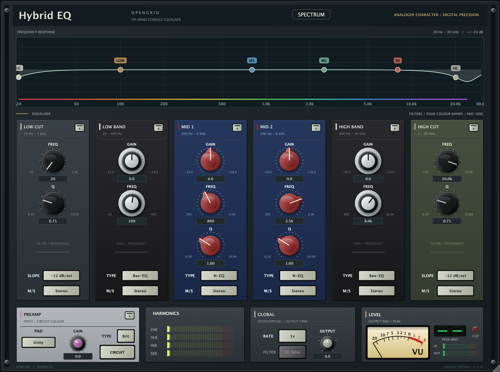

# HybridEQ
## User manual - version 1.6.14

Six-band console equaliser with preamp character, harmonic saturation and mid/side processing.

**Quick start**

- Insert HybridEQ on a stereo audio track or bus.
- Start with Standard preamp mode and 1x oversampling. These are the lightest options.
- Adjust a band's gain, frequency and Q; use its B key to compare the bypassed band.
- Match the output level with OUTPUT before comparing settings.
- Save your DAW project to store parameters and spectrum settings.

Version 1.6.14 improves editor drawing and removes delayed knob animation. It does not change the audio engine, parameter IDs or FFT resolution. The layout and hardware styles remain the same.

<!-- pagebreak -->

# Equaliser controls

The six strips share the same controls where applicable. Drag a knob to adjust its value. Knob pointers and the numeric readouts follow the current value immediately. In the response plot, drag a band point horizontally for frequency and vertically for gain; use the wheel over a point with Q to adjust its width.

| Band | Frequency range / initial value | Gain | Q / initial value |
|---|---|---|---|
| LOW CUT | 20 Hz - 1 kHz / 20 Hz | Filter only | 0.10 - 10.00 / 0.707 |
| LOW BAND | 20 - 400 Hz / 100 Hz | -18 to +18 dB / 0 dB | Fixed by type |
| MID 1 | 200 Hz - 6 kHz / 800 Hz | -18 to +18 dB / 0 dB | 0.10 - 10.00 / 1.00 |
| MID 2 | 200 Hz - 6 kHz / 2.5 kHz | -18 to +18 dB / 0 dB | 0.10 - 10.00 / 1.00 |
| HIGH BAND | 800 Hz - 30 kHz / 8 kHz | -18 to +18 dB / 0 dB | Fixed by type |
| HIGH CUT | 1 - 30 kHz / 20 kHz | Filter only | 0.10 - 10.00 / 0.707 |

**SLOPE:** Low Cut and High Cut offer -6, -12, -18 and -24 dB/oct labels. Both initially use -12 dB/oct.

**TYPE:** Low and High bands offer Bax-EQ, Brit and FSF; both start at Bax-EQ. Mid bands offer N-EQ, Brit and A-Type; both start at N-EQ. Mid-band Q is disabled for A-Type.

**M/S:** Each band can process Stereo, Mid or Side. All initially use Stereo. Mid/Side processing is meaningful on stereo material; the plotted response does not separately display both stereo paths.

**B:** Each band has an independent bypass key; all bands initially process audio.

Frequency controls extend to 30 kHz; the analyser stops at the session's Nyquist frequency. EQ response and the spectrum use different vertical scales: the EQ plot shows gain, while the analyser shows signal level.

<!-- pagebreak -->

# Preamp, harmonics and global controls

**PREAMP TYPE:** Off, Brit, N-Type, FSF and A-Type. The default is Brit. Off selects the clean preamp model. Use the type key's dropdown to select a model.

**PAD:** -20 dB, Unity or +10 dB; initially Unity. **GAIN:** -12 to +24 dB; initially 0 dB. **B:** bypasses the preamp section.

The CIRCUIT key cycles through three engines:

| Key state | Engine | Use |
|---|---|---|
| CIRCUIT unlit | Standard static models with anti-aliasing | Lightest preamp option |
| CIRCUIT lit | Reduced circuit model | Circuit character with lower CPU use |
| CIRCUIT HQ | Full component-level solver | Highest CPU use; 2x minimum oversampling |

HQ is the full solver, rather than an additional brightness or output-gain control. Older saved Circuit sessions retain their engine meaning. The unlit state is the initial mode.

**HARMONICS:** The 2nd, 3rd, 4th and 5th sliders independently set harmonic amounts from 0 to 1. All start at 0.

**RATE:** Choose 1x, 2x, 4x or 8x oversampling. The key displays the effective factor. An asterisk means an engine requirement raised it above the requested factor. HQ has a 2x floor. Higher factors increase CPU use.

**FILTER:** Choose IIR (Min) or FIR (Lin) for oversampling above 1x. IIR is minimum phase; FIR is linear phase. IIR is the default. The key is inactive at 1x. Oversampling affects latency; the host's latency report is settled during preparation.

**OUTPUT:** -24 to +24 dB; initially 0 dB. Use output trim to compare processed and bypassed levels fairly.

**Choice keys:** Slope, M/S, Band Type and Pad advance on left-click; right-click opens their choices. Preamp Type uses a dropdown. The CIRCUIT key cycles engines.

<!-- pagebreak -->

# Metering and spectrum

**LEVEL:** The output meter combines RMS/VU behaviour, peak readout, input/output ladders and a latching clip lamp. Click CLIP to reset it. Metering is for observation; it is not an additional limiter.

**Main analyser:** The spectrum is drawn behind the EQ response. Stored spectrum settings select input or output, FFT size, style, tilt, fall rate, opacity, peak hold, smoothing and colour map. The release interface does not expose the developer Spectrum Studio; existing saved settings are retained.

**SPECTRUM:** Opens the full-window analyser, initially in spectrogram view. The mode key switches between spectrum and spectrogram; CLOSE returns to the console. EQ nodes remain draggable on top of either view. The spectrogram places newest audio at the top and older frames below it.

FFT sizes are 512, 1024, 2048, 4096, 8192 and 16384 samples. A larger FFT gives finer frequency resolution and a longer analysis window. Analyser styles are Standard, Multicolour, Bars and Spectrogram. Optional octave smoothing and peak hold alter the display only.

In 1.6.14 the smaller analyser pauses behind the full-window view. Display columns and colours are reused, and only new spectrogram rows are coloured. FFT size, calibration and saved visual settings are preserved.

**Working on slower machines**

- Use Standard or reduced Circuit mode before HQ when CPU headroom is limited.
- Choose oversampling to suit the material and the available processing budget.
- Close unused plug-in editors and full-window analysers.
- If the whole interface remains sluggish, record the host, plug-in version, display scaling and graphics hardware when reporting it. Changing FFT size alone may not address an editor drawing problem.

Cached artwork follows editor resizing and physical display scale, including HiDPI. Local rendering tests do not establish a frame-rate guarantee on every Windows or graphics configuration.

<!-- pagebreak -->

# Installation, compatibility and support

**macOS:** macOS 11 or later; universal Apple silicon and Intel. The bundle archive contains VST3, AU, CLAP, LV2 and PACE-signed AAX. Use OpenGrid Plugin Manager, or copy the modules from the archive's Library tree into the corresponding folders on your system. Resources install under /Library/Application Support/HybridEQ/.

| Format | macOS destination |
|---|---|
| VST3 | /Library/Audio/Plug-Ins/VST3 |
| AU | /Library/Audio/Plug-Ins/Components |
| CLAP | /Library/Audio/Plug-Ins/CLAP |
| LV2 | /Library/Audio/Plug-Ins/LV2 |
| AAX | /Library/Application Support/Avid/Audio/Plug-Ins |

**Windows x64:** Windows 10 or later. The plugin-manager ZIP contains VST3, CLAP and LV2 under Common Files. The manager installs these beneath Program Files; resources are under Program Files/OpenGrid/HybridEQ. Administrator access may be needed. Windows AAX is not included in this release.

**Linux x86_64:** Extract the archive and copy VST3, CLAP and LV2 modules into the plug-in folders supported by your host, commonly ~/.vst3, ~/.clap and ~/.lv2. The release is built on Ubuntu 24.04; library requirements may limit older distributions. Linux AAX is not included.

Close the DAW before replacing plug-ins. Avoid duplicate old modules in system and user plug-in locations, then rescan in the host. Current downloads are plug-in archives; standalone applications are available as source-build targets rather than release payloads.

**Sessions and automation:** All 45 host parameters and their IDs are retained in 1.6.14. Save and reopen the host project to restore parameter state. Spectrum appearance is stored alongside the project state.

**Licence:** Official compiled binaries are proprietary freeware for personal and commercial audio work. HybridEQ's own source and the GoodLookinUI toolkit retain their MIT licences. See the included binary licence and third-party component notices. End users do not need developer signing credentials or SDK licences.

Support and downloads: https://github.com/MistaMin/HybridEQ
