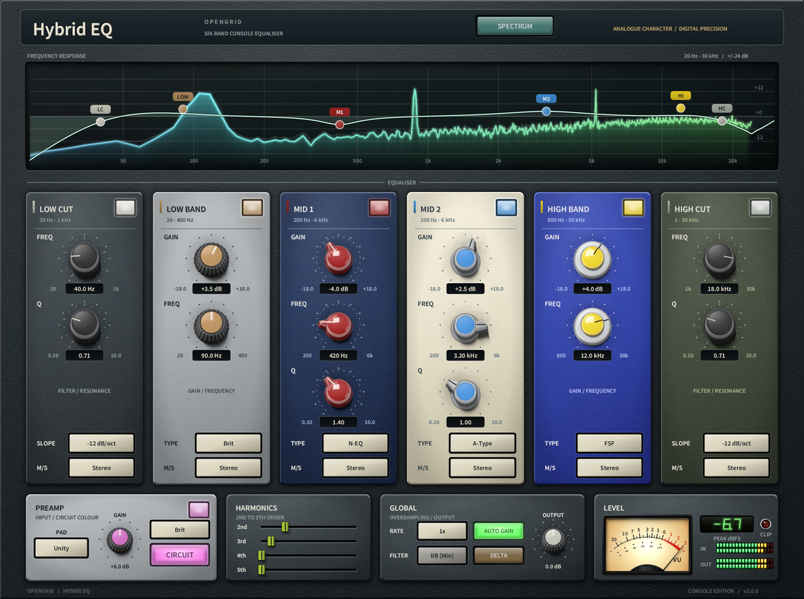
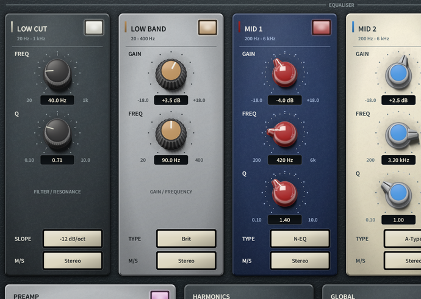
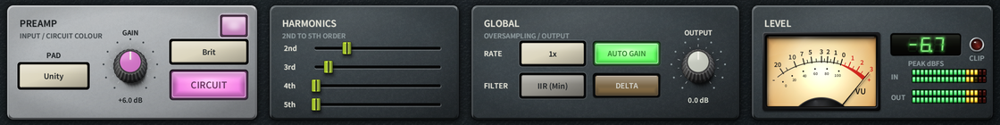

# HybridEQ
## User manual - version 2.0.0

Six-band console equaliser with preamp character, harmonic saturation and mid/side processing.

**Quick start**

- Insert HybridEQ on a stereo audio track or bus.
- Start with the CIRCUIT key unlit and 1x oversampling. These are the lightest options.
- Adjust a band's gain, frequency and Q; use the band's key at its top right to compare it bypassed.
- Turn on AUTO GAIN, or match the level with OUTPUT, before comparing settings by ear.
- Save your DAW project to store the parameters and the editor size.

Version 2.0.0 is HybridEQ rewritten in Rust. The equaliser, preamp circuits, harmonics and oversampling are the same models as in 1.6, and projects saved with 1.6 open with every setting. It adds AUTO GAIN and DELTA, a resizable editor, sample-accurate automation, and Windows ARM64 and Linux aarch64 builds. Three details differ from 1.6 on purpose; they are explained under "What changed from 1.6".

<!-- pagebreak -->

# Equaliser controls

The six strips share the same controls where applicable. Drag a knob up or down to change its value; hold Shift for fine steps. Double-click a knob to return it to its initial value, or turn the mouse wheel over it. The readout under each knob shows the value at most three digits long (25 Hz, 2.50 kHz, Q 0.71, Q 10.0).

In the response plot, drag a band's point sideways for frequency and up or down for gain. Turn the mouse wheel over a point to change its Q.

| Band | Frequency range / initial value | Gain | Q / initial value |
|---|---|---|---|
| LOW CUT | 20 Hz - 1 kHz / 20 Hz | Filter only | 0.10 - 10.0 / 0.71 |
| LOW BAND | 20 - 400 Hz / 100 Hz | -18 to +18 dB / 0 dB | Fixed by type |
| MID 1 | 200 Hz - 6 kHz / 800 Hz | -18 to +18 dB / 0 dB | 0.10 - 10.0 / 1.00 |
| MID 2 | 200 Hz - 6 kHz / 2.50 kHz | -18 to +18 dB / 0 dB | 0.10 - 10.0 / 1.00 |
| HIGH BAND | 800 Hz - 30 kHz / 8.00 kHz | -18 to +18 dB / 0 dB | Fixed by type |
| HIGH CUT | 1 - 30 kHz / 20.0 kHz | Filter only | 0.10 - 10.0 / 0.71 |

**SLOPE:** Low Cut and High Cut offer -6, -12, -18 and -24 dB/oct. Both start at -12 dB/oct.

**TYPE:** The Low and High bands offer Bax-EQ, Brit and FSF; both start at Bax-EQ. The Mid bands offer N-EQ, Brit and A-Type; both start at N-EQ. A-Type has a fixed Q, so its Q knob has no effect. Each type gives its strip its own plate, knob style and colour.

**M/S:** Each band processes Stereo, Mid or Side. All start at Stereo. Mid and Side are meaningful on stereo material; the response plot shows one curve per band.

**Band key (top right of each strip):** lit when the band processes audio; click it to bypass the band. A bypassed band drops out of the response curve.

**Choice keys** (SLOPE, TYPE, M/S, PAD, the preamp type, RATE and FILTER): click to step forward, right-click to step back.

**Host menu:** right-click a knob, a fader, a band key, a point in the response plot or the CIRCUIT key to open your DAW's menu for that parameter (automation, MIDI learn), where the DAW offers one.

Frequency controls reach 30 kHz; the analyser stops at the session's Nyquist frequency. The response plot shows gain, the analyser behind it shows signal level, on separate scales.

<!-- pagebreak -->

# Preamp, harmonics and global controls

**Preamp type:** Off, Brit, N-Type, FSF and A-Type. Brit is the initial type. Off selects the clean preamp model.

**PAD:** -20 dB, Unity or +10 dB; initially Unity. **GAIN:** -12 to +24 dB; initially 0 dB. **Preamp key (top right):** bypasses the preamp section.

The CIRCUIT key cycles through three engines:

| Key state | Engine | Use |
|---|---|---|
| CIRCUIT unlit | Static models with anti-aliasing | Lightest preamp option |
| CIRCUIT lit | Reduced circuit model | Circuit character with lower CPU use |
| CIRCUIT HQ | Full component-level circuit solver | Highest CPU use; 2x minimum oversampling |

HQ is the full solver, not an extra brightness or output control. A project from 1.6.11 or earlier that used Circuit opens in HQ, which is what Circuit meant then.

**HARMONICS:** The 2nd, 3rd, 4th and 5th faders each set a harmonic amount from 0 to 100 %. All start at 0.

**RATE:** 1x, 2x, 4x or 8x oversampling. The key shows the factor in effect; an asterisk means an engine raised it above the factor you chose (HQ needs at least 2x). Higher factors cost more CPU.

**FILTER:** IIR (Min) or FIR (Lin) anti-alias filters for oversampling above 1x. IIR is minimum phase and adds no latency of its own; FIR is linear phase and adds latency, which HybridEQ reports to the DAW. IIR is the initial choice. The key is dimmed at 1x.

**OUTPUT:** -24 to +24 dB; initially 0 dB.

**AUTO GAIN (new in 2.0):** holds the output at the loudness of the input, so you hear what the EQ does to the tone and not that it got louder. It compares the K-weighted loudness (ITU-R BS.1770) of the input and of the processed signal over the last 3 seconds and corrects the difference, up to 24 dB either way, gliding over 50 ms. Below -70 LUFS (silence, tails) it holds its correction. It acts after OUTPUT. Initially off.

**DELTA (new in 2.0):** plays only what HybridEQ changes: the processed signal minus the input, lined up for latency. When HybridEQ changes nothing (every section bypassed, OUTPUT at 0 dB, AUTO GAIN off) it is silent. OUTPUT and AUTO GAIN act before DELTA, so a level change shows in the difference. It fades in and out without a click. Initially off. Remember to turn it off before you bounce.

<!-- pagebreak -->

# Metering, spectrum and window

**LEVEL:** a VU meter (0 VU = -18 dBFS), a peak readout in dBFS with hold, IN and OUT ladders, and a clip lamp that stays lit until you click it. The meters observe; they do not limit.

**Analyser:** a spectrum of the output is drawn behind the response curve.

**SPECTRUM:** opens the full-window analyser, starting as a spectrogram (newest audio at the top). The key at the top right switches between spectrogram and spectrum; CLOSE returns to the console. The band points stay draggable on both views. While the full-window view is open, the small analyser behind the curve pauses.

**Window size:** resize the plug-in window in your DAW. The editor keeps its proportions between 826 x 616 and 1770 x 1320 points, and the size is saved with the project.

**Working on slower machines**

- Use the CIRCUIT key unlit, or lit, before HQ when CPU headroom is limited.
- Choose the oversampling factor to suit the material and the processing budget.
- Close plug-in editors and the full-window analyser when you do not need them.

<!-- pagebreak -->

# What changed from 1.6

HybridEQ 2.0.0 is a drop-in replacement for 1.6.16: the same plug-in IDs in every format, the same parameter IDs and ranges, and 1.6 projects open with every setting and their automation. The sound is the same: renders of 2.0.0 and 1.6.16 cancel to -119 dBFS or lower in the equaliser, preamp and circuit tests, except in the three places below. Each was changed on purpose.

**1. No polarity flip from the FSF high shelf.**
In 1.6, an FSF high shelf boosted close to the top of the spectrum (for example 20 kHz, +10 dB at 48 kHz) could come out with its polarity inverted: the filter design that matches the analogue curve settled on the mirror image of the correct filter. The level sounded right, but the whole signal was upside down. 2.0.0 always keeps the polarity of the input.
*Why this is better:* a flipped signal partly cancels when it is mixed with anything that is not flipped: parallel processing, a dry blend, other microphones on the same source, or DELTA. The curve and the level are unchanged.

**2. New oversampling filters.**
1.6 used the anti-alias filters of the framework it was built on; 2.0.0 has its own. IIR (Min) keeps 1.6's delay and passband level (within 0.02 dB from 20 Hz to 20 kHz); its phase differs only in the top octave. Through the HQ circuit that phase difference slightly changes the highest harmonics; levels are the same. FIR (Lin) is still linear phase, with 11 samples more latency at 4x (72 instead of 61) and 9 more at 8x (75 instead of 66); HybridEQ reports it to the DAW, which compensates.
*Why this is better:* the filters are part of HybridEQ, so they are tested with it on every build. The tests hold the passband within 0.05 dB at every factor and keep aliasing from content above the session's Nyquist frequency below -90 dB. A future framework update cannot change them.

**3. A new host bypass in VST3.**
Your DAW's own bypass for HybridEQ is now a latency-aligned crossfade: while bypassed, the output is the input delayed by exactly HybridEQ's latency, and switching starts at the exact sample, so the bypass is click-free and stays in time with the rest of the mix. The bypass parameter has a new ID in VST3.
*What this means for old projects:* in a VST3 project from 1.6, automation of the DAW's bypass switch for HybridEQ does not carry over. Everything else, including HybridEQ's own band and preamp keys, opens as saved. This concerns VST3 only.

**Also new:** automation lands on the exact sample (1.6 applied it at the start of each audio block), AUTO GAIN and DELTA, a resizable editor, and Windows ARM64 and Linux aarch64 builds.

<!-- pagebreak -->

# Installation, compatibility and support

**macOS:** macOS 11 or later, universal (Apple silicon and Intel). The signed and notarized installer offers VST3, AU, CLAP, LV2 and PACE-signed AAX.

| Format | macOS destination |
|---|---|
| VST3 | /Library/Audio/Plug-Ins/VST3 |
| AU | /Library/Audio/Plug-Ins/Components |
| CLAP | /Library/Audio/Plug-Ins/CLAP |
| LV2 | /Library/Audio/Plug-Ins/LV2 |
| AAX | /Library/Application Support/Avid/Audio/Plug-Ins |

**Windows:** Windows 10 or later, x64 or ARM64; choose the installer for your processor. It installs VST3, CLAP and LV2 under Common Files (VST3, CLAP, LV2); you can deselect formats. The installer is not code-signed, so Windows SmartScreen may warn before it runs ("More info", then "Run anyway"). AAX for Windows is not included.

**Linux:** x86_64 or aarch64, glibc 2.35 or later (Ubuntu 22.04, Debian 12, Fedora 36 and later). The archive holds usr/lib/vst3, usr/lib/clap and usr/lib/lv2: copy the plug-ins into ~/.vst3, ~/.clap and ~/.lv2, or into /usr/lib/vst3, /usr/lib/clap and /usr/lib/lv2 for every user. The editor needs an X11 display (Xwayland works).

Close the DAW before replacing plug-ins. Remove older copies from both the system and the user plug-in folders, then rescan in the host. HybridEQ has no standalone application.

**Sessions and automation:** all 45 parameters of 1.6 keep their IDs, plus AUTO GAIN and DELTA. Save and reopen the project to restore every setting and the editor size.

**Licence:** the official binaries are proprietary freeware for personal and commercial audio work. HybridEQ's source is MIT licensed. See the included binary licence and the third-party notices.

Support and downloads: https://github.com/MistaMin/HybridEQ
