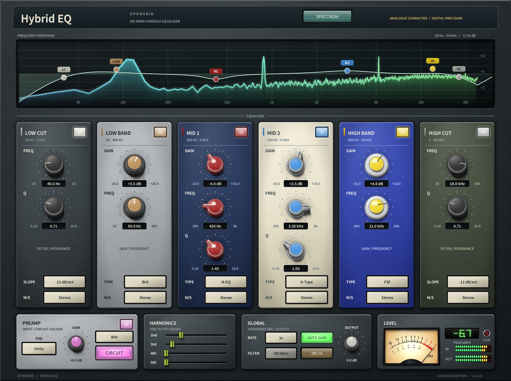
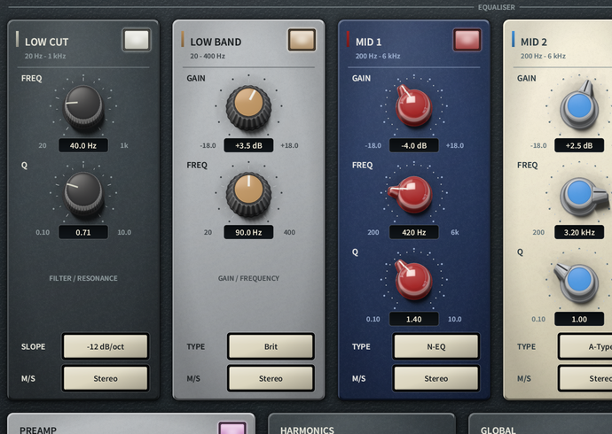
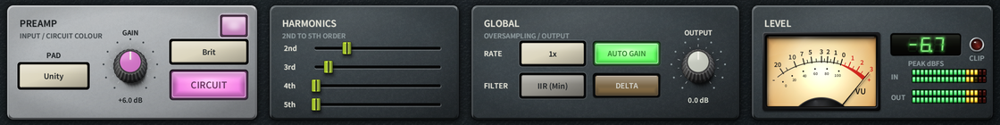

# HybridEQ

**A console-style channel strip: six-band EQ, four analogue-modelled preamp circuits, harmonics and
mid/side, by OpenGrid.**



| Band strips | Preamp, harmonics, global and level |
|---|---|
|  |  |

## Version 2.0.0

- HybridEQ rewritten in Rust: the same EQ, preamp circuits, harmonics and oversampling, and 1.6
  projects open with every setting.
- New AUTO GAIN (loudness-matched comparisons) and DELTA (hear only what changes).
- A resizable editor with crisper text on every screen, and sample-accurate automation.
- Windows (x64 and ARM64) and Linux (x86_64 and aarch64) builds alongside macOS.
- Three deliberate differences from 1.6 are explained in the manual's "What changed from 1.6".

## Download

| System | Download | Formats |
|---|---|---|
| macOS 11+, Apple silicon and Intel | [HybridEQ-2.0.0-macos.pkg](https://github.com/MistaMin/HybridEQ/releases/download/v2.0.0/HybridEQ-2.0.0-macos.pkg) | VST3, AU, AAX, CLAP, LV2 |
| Windows 10+, x64 | [HybridEQ-2.0.0-windows-x64-setup.exe](https://github.com/MistaMin/HybridEQ/releases/download/v2.0.0/HybridEQ-2.0.0-windows-x64-setup.exe) | VST3, CLAP, LV2 |
| Windows 10+, ARM64 | [HybridEQ-2.0.0-windows-arm64-setup.exe](https://github.com/MistaMin/HybridEQ/releases/download/v2.0.0/HybridEQ-2.0.0-windows-arm64-setup.exe) | VST3, CLAP, LV2 |
| Linux x86_64, glibc 2.35+ | [HybridEQ-2.0.0-linux-x86_64.tar.gz](https://github.com/MistaMin/HybridEQ/releases/download/v2.0.0/HybridEQ-2.0.0-linux-x86_64.tar.gz) | VST3, CLAP, LV2 |
| Linux aarch64, glibc 2.35+ | [HybridEQ-2.0.0-linux-aarch64.tar.gz](https://github.com/MistaMin/HybridEQ/releases/download/v2.0.0/HybridEQ-2.0.0-linux-aarch64.tar.gz) | VST3, CLAP, LV2 |

Each download has a `.sha256` file beside it on the [release page](https://github.com/MistaMin/HybridEQ/releases/tag/v2.0.0).

- **macOS:** a Developer ID signed and notarized installer; the AAX is PACE-signed for Pro Tools. It
  installs every format to the system plug-in folders. The OpenGrid Plugin Manager offers the same installer.
- **Windows:** an installer in which you choose the formats; it installs to Common Files. It is not
  code-signed, so Windows SmartScreen may warn before it runs.
- **Linux:** an archive with `usr/lib/vst3`, `usr/lib/clap` and `usr/lib/lv2`; copy the plug-ins to
  `~/.vst3`, `~/.clap` and `~/.lv2`, or to `/usr/lib` for every user.
- **Not included:** AAX for Windows, and a standalone application.
- **Tested:** the macOS build in REAPER (VST3, AU and CLAP), with auval and the AAX Validator. The
  Windows and Linux builds pass the CLAP and VST3 validators on each processor, and on x64 pluginval,
  which opens the editor; they have not yet been tried in a DAW by hand.

## User guide

- [User manual](Docs/UserManual.md) (the PDF is on the release page)
- [Changelog](CHANGELOG.md) and [release notes](RELEASE_NOTES.md)

## What it does

- **Models:** Brit, N-Type, FSF and A-Type, plus a clean Off model. Each EQ band can
  also be switched between circuit flavours (N-Type, Brit, A-Type, Baxandall, FSF).
- **One key, three modes.** The preamp's circuit key steps through them on each click:

  | Key | Mode | What runs | Oversampling |
  |---|---|---|---|
  | CIRCUIT (unlit) | Standard | Light static waveshapers with ADAA anti-aliasing | none needed |
  | CIRCUIT (lit) | Circuit | Reduced circuit model with its own ADAA at 1x | none needed |
  | CIRCUIT HQ | HQ | Full component-level circuit solver (transistors, op-amps, saturating transformers) | 2x minimum |

- **Oversampling** 1x / 2x / 4x / 8x is your choice, with selectable IIR (minimum-phase) or FIR (linear-phase) anti-aliasing filters. HQ raises the minimum to 2x (the key then
  reads `2x*`); Standard and Circuit run at 1x with no latency.
- **Cramping-free EQ:** High Cut, High shelf and bells are fitted to the analogue curve at
  the base rate, so they follow it near Nyquist without oversampling.
- Six EQ bands with Mid/Side per band, harmonic saturation (2nd to 5th), VU and peak
  metering, and a full-window spectrum / spectrogram view with draggable EQ points.
- **AUTO GAIN** holds the output at the input's loudness (ITU-R BS.1770), so a comparison is
  about tone, not level. **DELTA** plays only what HybridEQ changes.


### Circuit history

Each flavour is inspired by a studio classic:

- **N-Type** is inspired by Rupert Neve's 1073 preamp module, which first appeared in a console built in 1970 and became one of the most celebrated mic preamps ever made ([history](https://www.ams-neve.com/consoles/history-of-1073/)).
- **FSF** is inspired by Focusrite's console channel, which began with a 1985 commission from Sir George Martin and grew into one of the most influential names in recorded sound ([story](https://eu.focusrite.com/our-story)).
- **Brit** is inspired by Solid State Logic, founded in 1969 by Colin Sanders, whose 1979 SL 4000 E Series ranks among the most groundbreaking mixing consoles ever built ([history](https://solidstatelogic.com/our-history)).
- **A-Type** is inspired by API's 512 mic preamp, one of the most iconic 500 Series modules, from a company founded in 1969 around the 2520 discrete op-amp ([about](https://apiaudio.com/about/)).

**Trademark notice.** Neve, 1073, Focusrite, Solid State Logic (SSL), API and 512 are trademarks of their respective owners. AAX and Pro Tools are trademarks of Avid Technology, Inc. VST is a trademark of Steinberg Media Technologies GmbH. HybridEQ is an independent project: those companies are not affiliated with, and have not endorsed or sponsored, Marcos Quirino Deida, the OpenGrid Project or this plug-in. The names appear only to describe the classic designs that inspired each model; every model here is an independent circuit simulation, and no code or text from those companies is included.


## Build from source

HybridEQ is written in Rust. The engine (`crates/engine`) has no dependencies; the plug-in
(`plugin`) uses [OpenPluginSDK](https://github.com/MistaMin/OpenPluginSDK) and
[GoodLookin DRI](https://github.com/MistaMin/GoodLookinDri). Until their pending changes are merged,
check out these branches side by side:

```bash
git clone -b MistaMin/hybrideq-host-values https://github.com/MistaMin/OpenPluginSDK
git clone -b MistaMin/semibold-text https://github.com/MistaMin/GoodLookinDri
git clone https://github.com/MistaMin/HybridEQ && cd HybridEQ
OPENPLUGIN_SDK=../OpenPluginSDK . scripts/sdk_env.sh     # points cargo at the SDK
cargo test --release --manifest-path crates/engine/Cargo.toml
cargo test --release --manifest-path plugin/Cargo.toml
```

The plug-ins are built by the SDK's scripts: `scripts/build_plugin.sh` on macOS (add
`--archs universal`), `scripts/windows/build_plugin.ps1` on Windows and
`scripts/build_plugin_linux.sh` on Linux. The VST3 format needs the
[VST3 SDK](https://github.com/steinbergmedia/vst3sdk), the Audio Unit the AudioUnitSDK, and AAX Avid's
AAX SDK (not public; official AAX builds are PACE-signed). `.github/workflows/windows-linux.yml` shows
the complete Windows and Linux builds.

Repository layout:

| Folder | What it holds |
|---|---|
| `crates/engine` | the DSP: EQ, preamp circuits and solver, harmonics, parameters |
| `plugin` | the plug-in: formats, state, oversampling, editor; `src/bin/preview.rs` renders the editor |
| `installer` | the macOS and Windows installers |
| `Docs` | the user manual and its pictures |
| `qa` | test evidence for each release |
| `Source`, `CMakeLists.txt` | the 1.6 C++ implementation, kept as the reference the Rust port is measured against |

## License

HybridEQ's source code is [MIT licensed](LICENSE), Copyright (c) 2026 Marcos Quirino Deida. The
official compiled plug-ins and installers are **proprietary freeware**, free for personal and commercial
audio work, under the [binary freeware license](BINARY_LICENSE.txt). The licenses of every component
(OpenPluginSDK, GoodLookin DRI, the Rust crates, the Source Sans Pro typeface and the format SDKs) are
listed in [THIRD_PARTY_NOTICES.txt](THIRD_PARTY_NOTICES.txt), with their texts in
[`Licenses/third-party`](Licenses/third-party); the installers carry them too. The AAX SDK is Avid's
and is not part of this repository.

AAX and Pro Tools are trademarks of Avid Technology, Inc. VST is a trademark of Steinberg Media
Technologies GmbH.
