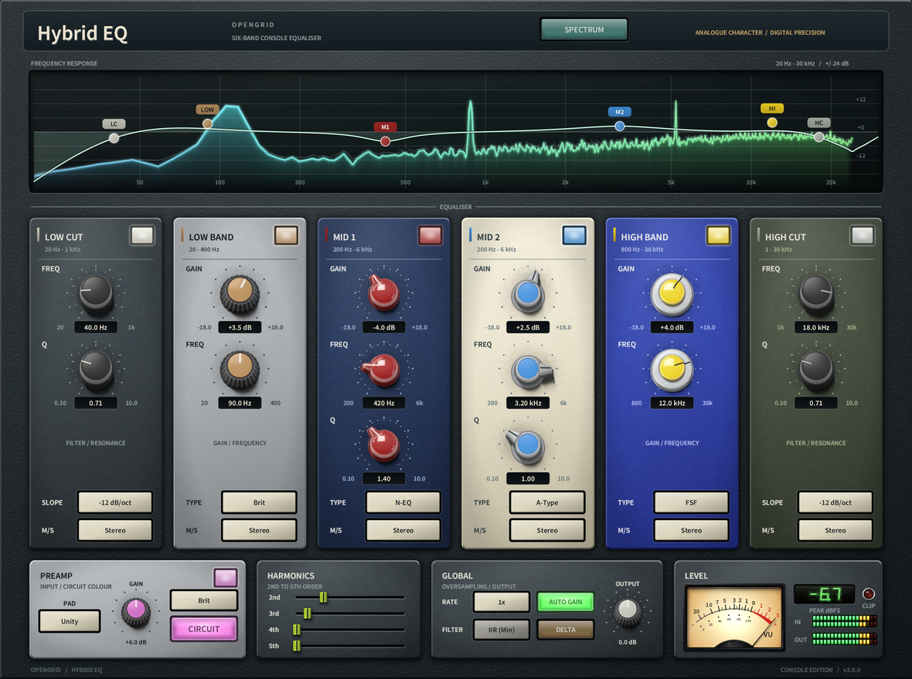

# HybridEQ 2.0.0

HybridEQ rewritten in Rust: the same six-band EQ, four preamp circuits, harmonics and oversampling,
now with AUTO GAIN and DELTA, a resizable editor, and Windows and Linux builds for x64 and ARM. It
replaces 1.6.16 in place: the same plug-in IDs in every format, the same parameter IDs, and 1.6
projects open with every setting.

## What is new

- **AUTO GAIN** holds the output at the input's loudness (ITU-R BS.1770, 3 s window, ±24 dB), so
  you compare tone and not level.
- **DELTA** plays only what HybridEQ changes: the processed signal minus the latency-aligned input.
- **Editor:** resizes in proportion (826 x 616 to 1770 x 1320 points), keeps its size in the
  project, and draws its text crisply at every window size.
- **Automation** lands on the exact sample.
- **Windows ARM64 and Linux aarch64** builds; Windows ships as an installer.

## Differences from 1.6 (on purpose)

The manual's "What changed from 1.6" explains each, and why it is better:

1. The FSF high shelf no longer inverts the signal's polarity when boosted near the top of the spectrum.
2. New oversampling filters: IIR keeps 1.6's delay and level (phase differs in the top octave);
   FIR adds 11 samples of latency at 4x and 9 at 8x, reported to the DAW.
3. VST3: the DAW's bypass for HybridEQ is a latency-aligned crossfade with a new parameter ID, so
   automation of that bypass switch in 1.6 VST3 projects does not carry over.

## Downloads

| File | System | Formats |
|---|---|---|
| HybridEQ-2.0.0-macos.pkg | macOS 11+, Apple silicon and Intel | VST3, AU, AAX (PACE-signed), CLAP, LV2 |
| HybridEQ-2.0.0-windows-x64-setup.exe | Windows 10+, x64 | VST3, CLAP, LV2 |
| HybridEQ-2.0.0-windows-arm64-setup.exe | Windows 10+, ARM64 | VST3, CLAP, LV2 |
| HybridEQ-2.0.0-linux-x86_64.tar.gz | Linux x86_64, glibc 2.35+ | VST3, CLAP, LV2 |
| HybridEQ-2.0.0-linux-aarch64.tar.gz | Linux aarch64, glibc 2.35+ | VST3, CLAP, LV2 |
| HybridEQ-2.0.0-User-Manual.pdf | | the user manual |
| opengrid-manifest.json | | sizes and SHA-256 of the installers, for the Plugin Manager |

Every download has a `.sha256` file.

**Install.** macOS: run the installer (Developer ID signed and notarized). Windows: run the
installer for your processor and choose the formats; it is not code-signed, so SmartScreen may ask
first ("More info", "Run anyway"). Linux: copy `usr/lib/vst3`, `usr/lib/clap` and `usr/lib/lv2` from
the archive to `~/.vst3`, `~/.clap` and `~/.lv2`. Close the DAW first, remove older copies, rescan.

## Checks

All five downloads were built from HybridEQ `f9e6307` (later commits change only documents and CI) and
GoodLookin DRI `333a952`. macOS was built on a Mac with OpenPluginSDK `b01d07a`. Windows and Linux were each
built on their own GitHub runner with OpenPluginSDK `c5446e7`, which adds only the Linux editor's frame
pacing (code macOS does not compile).

| Check | macOS | Windows x64 | Windows ARM64 | Linux x86_64 | Linux aarch64 |
|---|---|---|---|---|---|
| Engine and plug-in tests (including the null tests against 1.6.16 renders) | pass | pass | pass | pass | pass |
| VST3 SDK validator | 47 / 47 | 47 / 47 | 47 / 47 | 47 / 47 | 47 / 47 |
| clap-validator 0.4.1 | 34 pass, 0 fail | 33 pass, 0 fail | 33 pass, 0 fail | 34 pass, 0 fail | 34 pass, 0 fail |
| pluginval, strictness 10 (VST3) | pass (no editor tests) | pass, with the editor | not available | pass, with the editor | not available |
| auval | pass (2.0.0) | | | | |
| AAX Validator (signed AAX) | 6 / 6 | | | | |
| Signing | Developer ID, notarized, PACE | none | none | | |

A macOS build from earlier the same day passed the REAPER host tests in VST3, AU and CLAP: every
parameter acts and is on screen, renders repeat exactly, the editor reopens, and settings survive
saving and reopening the project.

## Known limits

- The Windows and Linux builds have passed the validators but have not been tried in a DAW by hand.
  The ARM builds were validated on ARM machines without pluginval, which ships for x64 only.
- AAX is macOS only. There is no standalone application.
- The Windows installer is not code-signed.
- The Linux editor needs X11 (Xwayland works).
